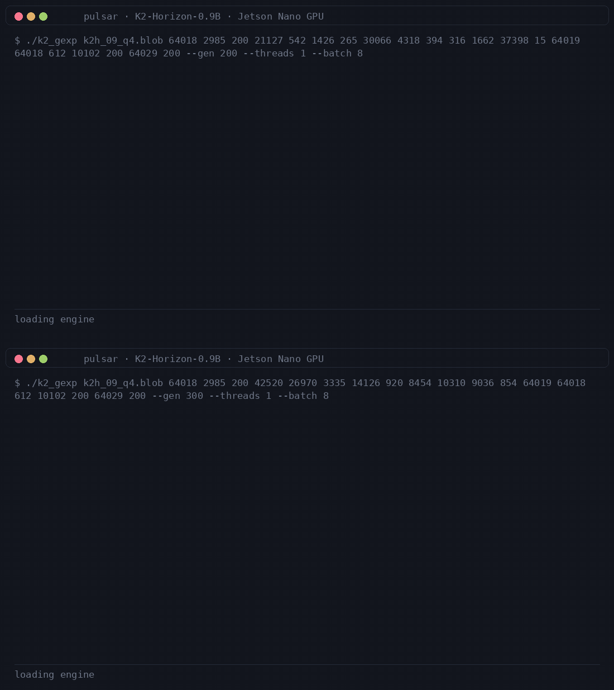

# PULSAR-ASM: K2-Horizon-0.9B on a Jetson Nano

A 0.9-billion-parameter language model running at **11-12 tokens/s decode on a
Jetson Nano Gen1**, the 2019 4 GB board, using its 128-core Maxwell GPU. The model
is IFM's **K2-Horizon-0.9B** (dense Llama-style decoder, GQA), quantized to Q4.
The host side of the engine is hand-written AArch64 assembly; the GPU side is
a hand-written PTX kernel driven from a small C runtime.

| | |
|---|---|
| Model | `IFM/K2-Horizon-0.9B`: 28 layers, hidden 1536, intermediate 5120, 32 q-heads / 8 kv-heads, head_dim 64, vocab 64256 |
| Weights | Q4_0-style blocks (32 weights, fp16 scale), `k2h_09_q4.blob`, 748,976,168 bytes, md5 `1b026978510f9111bb0a6a6607f3c50d` |
| Engine | AArch64 assembly (`.auto/rescue/k2_cuda.S`) + C runtime (`pulsar_arm/k2horizon/gpu_v52/k2_gexp_engine_v52.c`) that `dlopen`s the L4T `libcuda` and JIT-loads one PTX kernel (sm_50 PTX, runs on sm_53). No CUDA toolkit, cuBLAS or Python at runtime |
| Accuracy | every GEMV bit-identical to the engine's own scalar CPU reference; greedy streams frozen as goldens (logits to 4 decimals) and enforced by a gate on every change |

## Demo



Both runs are greedy and use the model's **ceiling prompts**, the hardest
prompts it answers correctly in each language (found by probing, see
`pulsar_arm/k2horizon/eval/ZH_CEILING.md`):

- **English:** "Explain what a neural network is in two sentences." (the seasons
  list loops and a haiku rambles under greedy decoding, so they don't qualify).
- **Traditional Chinese:** 「請說出光的三原色。」 ("Name the three primary colors of
  light."), written in Traditional Chinese. Of 19 zh-TW probes
  (`pulsar_arm/k2horizon/eval/ZH_TW_PROMPT_CEILING_NANO.md`) it is the hardest one
  answered correctly, and the only one answered with a full sentence:
  三原色（三主要颜色）是紅、綠、藍。 The model is English-leaning: it deliberates in
  English first. Two slips are kept as generated: the deliberation misquotes the
  prompt as 請出光的三原色, and the answer contains one simplified character (颜).

```sh
./k2_gexp k2h_09_q4.blob 64018 2985 200 21127 542 1426 265 30066 4318 394 316 1662 37398 15 64019 64018 612 10102 200 64029 200 --gen 200 --threads 1 --batch 8   # en
./k2_gexp k2h_09_q4.blob 64018 2985 200 42520 26970 3335 14126 920 8454 10310 9036 854 64019 64018 612 10102 200 64029 200 --gen 300 --threads 1 --batch 8   # zh-TW
```

How the clip was made, and what it is not:

- The streams come from the committed engine on the Nano (`jetson_clocks`; GPU
  921.6 MHz and CPU 1.479 GHz observed during decode), detokenized with the base
  tokenizer. The English one matches `.auto/k2nano_golden.txt` (216 steps) exactly
  and is identical to the phone transcript of the same prompt. The zh-TW one
  (268 steps) reruns byte-identical; it is not one of the gate's goldens.
- The status bar shows **decode-only** rates, measured as the difference between a
  `--gen N` run and a `--gen 0` run (median of 3): English 81.4 ms/token
  (12.3 tok/s) over 195 generated steps, Chinese 87.8 ms/token (11.4 tok/s) over
  249 steps. The Chinese run is slower because it goes deeper into the context,
  and attention grows with it.
- The frames are rendered at a fixed cadence, **not** in real time; only the
  pacing is a liberty. The transcripts are literals in
  `pulsar_arm/tools/make_chat_gif.py`, so re-rendering can only reproduce these
  frames: `python3 -I pulsar_arm/tools/make_chat_gif.py k2-nano` (Pillow and
  ffmpeg needed).

## At a glance

| | |
|---|---|
| Board | Jetson Nano Gen1: Tegra X1, 4x Cortex-A57, one Maxwell SM (sm_53, 128 cores), 4 GB LPDDR4 shared by CPU and GPU. L4T R32.5.1, CUDA 10.2 |
| Decode | **12.3 tok/s** on the English demo (195 steps), 11.4 tok/s on the zh-TW demo (249 steps, deeper context) |
| Whole-run benchmark | **11.2 tok/s** (89-90 ms/step): 216 greedy steps on the English prompt, startup and the 21-token prefill included. This is the number the repository's bench reports |
| Prefill | token by token through the decode path, about the same speed as decode. `--gen 0` (startup plus the 21-token prompt) takes 3.1 s |
| CPU only | 1.11 tok/s on the same board (single A57 core, `k2_core_a57.S`) |
| Memory | about 850 MB peak RSS in the GPU run; context capped at 1536 positions |
| Conditions | `--threads 1` (the GPU path is single-thread by design), greedy, one sequence |

## How it works

At startup the Q4 weights are repacked once into 16-byte blocks in device memory
(single copy, no mirror). A decoded token then costs **113 GPU launches**: per layer
one merged q+k+v GEMV, the o projection, one merged gate+up GEMV and the down
projection (28 x 4), plus the 64256-row output head.

- **GPU (hand-written PTX).** One warp covers four rows. Each block of 32 Q4
  weights is unpacked with `bfe` and multiplied against Q8_K-quantized
  activations with `mad.lo.s32`, so the integer dots are exact. The float
  epilogue (`fmul` of the two scales, then `fma` accumulation, blocks in order) is
  the same arithmetic, in the same order, as the CPU scalar reference. That is what
  makes the output bit-identical, and it means the kernel's float chain cannot be
  reassociated.
- **CPU (assembly).** Embedding, RMS norms, RoPE, the KV-cache store, grouped-query
  attention with an f64 softmax sum, SwiGLU (with an `expf` that reproduces glibc's
  bit for bit), the Q8_K activation quantizer, the argmax or sampler. Attention
  is the largest CPU cost (about 8 ms/token); it is strictly ordered scalar
  arithmetic too, so it was made fast by data layout and loop structure, not by
  reassociation.
- **Per-call driver path.** Each GEMV round trip is: the activation block is written
  into mapped pinned memory and a tiny copy kernel moves it to the device (skipped
  when the bytes are unchanged, which happens on a large share of calls); the GEMV kernel writes its
  result straight into mapped pinned memory; completion is a timing-free CUDA
  event polled by the host; the result is read back with four interleaved 64-byte
  NEON streams, because that memory is uncached for the CPU and a plain `memcpy`
  reads it at 0.72 GB/s. Switches: `K2XQCOPY=0`, `K2YDIRECT=0`, `K2DEDUP=0` restore
  the older paths for A/B.
- **Where a token goes** (about 90 ms): roughly 61 ms of GPU kernel time, 15-20 ms of
  CPU work (attention first) and the rest driver submission and waiting. CPU and
  GPU work barely overlap, because every GEMV output feeds the next stage.

## Speed history

Every step below was kept only after the golden gate passed. Same-board A/B was
used throughout; the board drifts by a few percent from hour to hour, so only
figures from the same job are comparable.

| stage | tok/s (whole-run bench) |
|---|---|
| first GPU build (one thread per row, strided loads) | 1.19 |
| 4-row blocking with a single-copy 16-byte repack | 3.73 |
| event-based completion plus kernel tuning | 6.5-7.0 |
| merged q+k+v and gate+up launches (197 to 113 per token) | 8.6 |
| attention rewrite (interleaved score chains, register-resident accumulators, prefetch) | 10.3 |
| NEON quantizer, contiguous per-head KV layout, 16-row transposed score block, vector divide | 11.1 |
| 4-stream readback | 11.2 |
| timing-free event, direct result write, copy-kernel staging | 11.2 (about 1.3-2 ms/step more by paired timing; the bench's 1 ms resolution cannot show it) |

## Limits, measured and estimated

- **Measured dead ends.** Batched prefill through one `grid.z` launch gave about
  1 % (the cost is per-slot ALU work, not launch count); whole-step CUDA graph
  replay (0.87 tok/s), activations read straight from host memory by the GEMV
  kernel (5x slower), a managed-memory result buffer (8 % slower), L2-only or deeper
  attention prefetch, an 8-way score interleave and a 2-wide `expf` were all
  measured and discarded. The record is in
  `.auto/log.jsonl` and `.auto/ideas.md`.
- **Estimated ceiling, not measured:** from the SASS instruction mix the GEMV kernel
  looks ALU-issue bound (BFE and XMAD dominate; sm_53 has no `dp4a`), and removing
  every remaining CPU and driver cost would land near 14 tok/s with this
  arithmetic. Hardware counters are not available without root, so this is an
  inference from the instruction mix, not a profile.
- Prefill is not batched, so a long prompt costs about 80 ms per token.
- Context is capped at 1536 tokens; one sequence at a time; `--threads 1` only.
- The base model is English-leaning. Chinese answers longer than a few words loop or
  err (`eval/ZH_CEILING.md`); the meeting-agent fine-tune
  (`k2h_ft_q4`) runs on the same engine but is shown on the phone page.

## Accuracy

`bash .auto/measure.sh` builds on the Nano, runs four interleaved legs
(GPU, CPU, CPU, GPU) and compares the 216-step English greedy stream with the
golden, line by line (token ids and logits to four decimals). `bash .auto/checks.sh`
then runs the held-out Traditional Chinese stream (114 steps) against its golden.
At startup the engine also checks its first 8 GEMV calls against the scalar CPU
reference ("CUDA self-test OK (8/8 bit-exact)") and falls back to the CPU path if
they differ. None of these gates is ever overridden.

**What "bit-exact" means here.** It is bit-exact against this engine's own Q4
scalar reference, not against the bf16 checkpoint: the weights are quantized to
Q4 and the activations to Q8_K, so logits differ from a bf16 transformers run.
Earlier work checked the Q4 asm engine against the scalar C reference
(`pulsar_arm/k2horizon/fwd_k2.c`, logits included); see
`pulsar_arm/k2horizon/HANDOFF.md`.

## Build and run

On the Nano (gcc 7.5, the L4T driver; no toolkit needed):

```sh
cd pulsar_arm/k2horizon
as -march=armv8-a ../../.auto/rescue/k2_cuda.S -o k2.o
gcc -O2 -c gpu_v52/k2_gexp_engine_v52.c -o k2c.o
gcc -nostartfiles -o k2_gexp k2.o k2c.o -ldl
```

The weights come from the published safetensors (convert on any machine):

```sh
python3 k2_convert.py <IFM-K2-Horizon-0.9B snapshot> k2h_09_q4.blob [rope tables] --q4   # see the script's docstring
```

Run (token ids in, step lines out; tokenize on another machine with the IFM
tokenizer and chat template, which ends with `assistant\n<ifm|think>\n`):

```sh
sudo jetson_clocks
./k2_gexp k2h_09_q4.blob <prompt ids...> --gen N --threads 1 --batch 8
# prints: step <n> id_in=<id> top=<id> logit=<x.xxxx>
```

The CPU-only engine used as the reference leg of the bench is
`pulsar_arm/k2horizon/k2_core_a57.S`; `pulsar_arm/k2horizon/k2_core.S` is the
pure-assembly phone build. `bash .auto/k2nano_preflight.sh` checks that every
asset the bench needs is in place on both machines.

## Layout

```
.auto/rescue/k2_cuda.S               host engine (assembly): CPU stages, loader, sampler, driver glue
pulsar_arm/k2horizon/gpu_v52/        C runtime: libcuda via dlopen, PTX GEMV kernel, staging, completion
pulsar_arm/k2horizon/gpu_v*/         earlier kernel generations and driver probes, kept for the record
pulsar_arm/k2horizon/k2_core*.S      CPU-only assembly engines (Cortex-A57 and phone builds)
pulsar_arm/k2horizon/k2_convert.py   safetensors to Q4 blob; fwd_k2.c scalar C reference; k2_oracle.py
pulsar_arm/k2horizon/eval/           prompt probes (ceiling hunt) and fine-tune quality notes
pulsar_arm/tools/make_chat_gif.py    demo renderer; transcripts are literals
.auto/                               bench, gates, goldens, preflight, log.jsonl, ideas.md
doc/                                 demo GIFs; OTHER_ENGINES.md
```

## Other engines in this repository

The repository started as pure-assembly engines for other models and boards:
Gemma-3 on a Raspberry Pi 4 (a single static AArch64 binary with no libc), FunctionGemma,
the C + NEON Ternary-Bonsai 8B and 27B ports, and K2-Horizon on a phone CPU.
They still work and are documented in [doc/OTHER_ENGINES.md](doc/OTHER_ENGINES.md).
