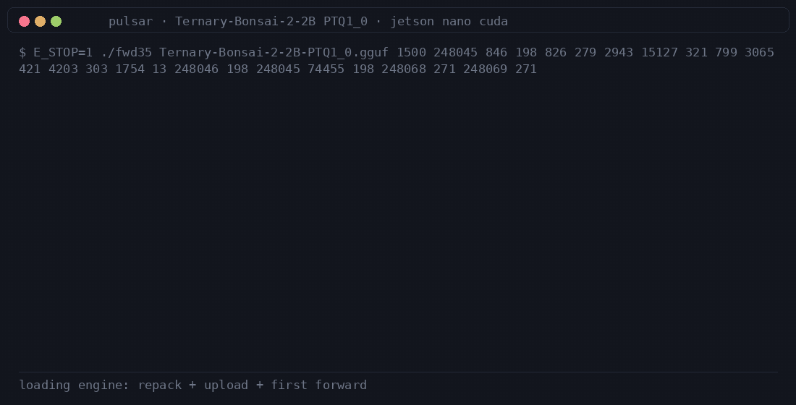
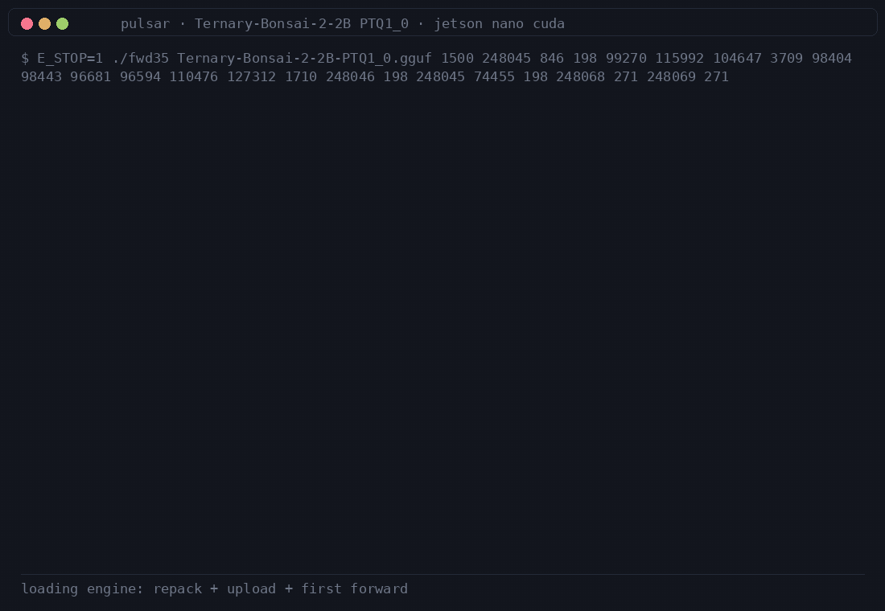
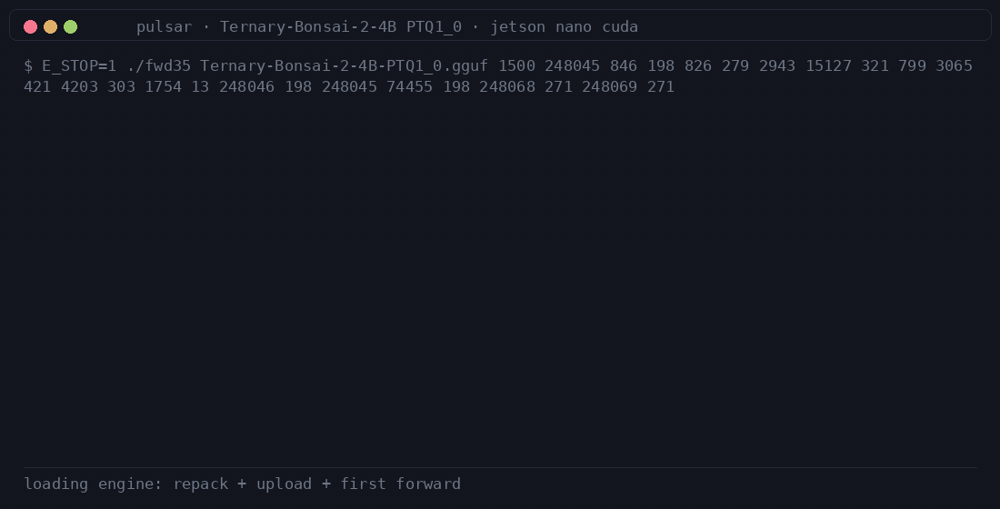
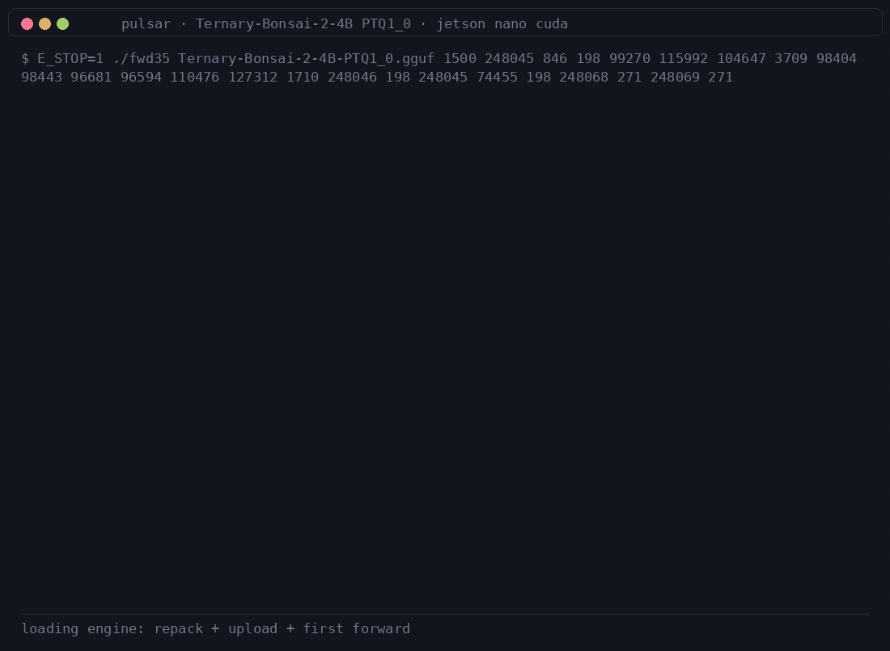
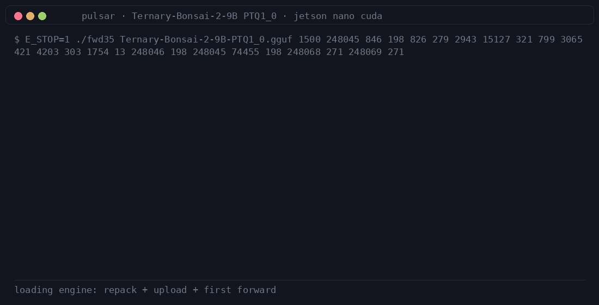
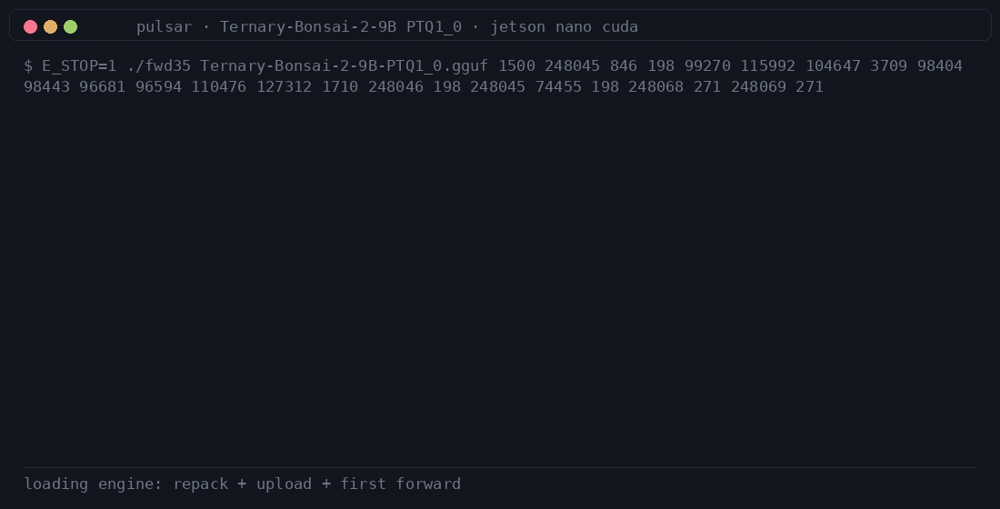

# PULSAR-ASM: Ternary-Bonsai-2 on a Jetson Nano

PrismML's **Ternary-Bonsai-2** family (2B, 4B, 9B) running on a **Jetson
Nano Gen1**, the 2019 4 GB board, on its 128-core Maxwell GPU. The
models are the `PTQ1_0` GGUFs: ternary weights packed 128 to a 28-byte
block with one f16 scale, 1.75 bits per weight. The architecture is `qwen35`,
a hybrid that puts one full-attention layer after every three Gated
DeltaNet (linear attention) layers.

## Performance at 4k context

| model | GGUF bytes | on the GPU | prefill, 3968 tokens | decode at 4k |
|---|---|---|---|---|
| Ternary-Bonsai-2-2B | 429,183,456 | 476 MB | **57.3 tok/s** | **24.2 tok/s** |
| Ternary-Bonsai-2-4B | 949,549,920 | 1064 MB | **22.5 tok/s** | **11.3 tok/s** |
| Ternary-Bonsai-2-9B | 1,997,486,976 | 2009 MB | **13.1 tok/s** | **7.0 tok/s** |

All three rows run the same 3968-token prompt
(`.auto/prompt_b2_4k_ids.txt`): a Traditional Chinese article with an
unrelated English appendix, in the chat template. The engine prefills it,
then decodes 64 greedy tokens. Prefill speed is 3968 tokens divided by the
prefill wall time. Decode speed covers the 63 steps after the first token,
each attending over 3968 to 4031 positions.

- **Build and conditions:** the 4B row is from commit 1ab76d2. The 2B and 9B
  rows were re-measured at 6fd0775, which adds k_li pipeline depth 2 for
  the 2B's K=6144 down GEMV (+0.8 % 2B decode). Default settings (8-token
  prefill chunks, exact f16 K/V cache), `jetson_clocks` (GPU 921.6 MHz,
  CPU 1.479 GHz), page cache dropped before each run, L4T R32.5.1, CUDA 10.2.
- **Runs:** each figure is one cold run. The 4B figures are the mean of the two
  default-setting runs of the same-job E_FVXP sweep at 1ab76d2
  (22.52 / 22.50 and 11.29 / 11.30). All three 4k streams equal their
  goldens at 1ab76d2, and the 2B and 9B streams again at 6fd0775. The board
  drifts 2 to 6 % between hours, so the 9B's 7.0 against an earlier 7.1 is
  drift (no 9B code path changed).
- **Exactness at 4k:** the reference is the PrismML fork's greedy stream on
  the same prompt (`fork_greedy`, one thread, 32-token ubatches, flash
  attention on, f16 cache).
  - **4B:** the 64-token stream equals the fork's. It is the harness gate
    (`.auto/golden_b2_4b_4k.txt`).
  - **2B and 9B:** the 64-token streams equal the fork's
    (`.auto/golden_b2_2b_4k.txt`, `.auto/golden_b2_9b_4k.txt`). The 2B used to
    leave the fork's stream at step 21. The cause was RoPE: the fork's
    `cosf`/`sinf` pair is fused by GCC into x86 glibc's `sincosf`, whose sin
    differs from `sinf` for 2^-27 <= |x| < 2^-5. The engine now transcribes
    that path (`gm_sincos_sinf`, exhaustively equal over all floats).

### Why the short-prompt figures are higher

The same build on English prompt A (24 prompt tokens, run to the model's
own end of turn) gives:

| model | prefill, 24 tokens | decode, ≤ 125 positions |
|---|---|---|
| 2B | 58.2 tok/s | 28.5 tok/s |
| 4B | 24.7 tok/s | 13.6 tok/s |
| 9B | 13.5 tok/s | 7.8 tok/s |

Decode is slower at 4k because every full-attention layer reads the whole
K/V cache at every step. For the 4B at 4k (nvprof, ms per decoded token),
the weight GEMVs take ~59 of the ~102 ms step, the same as on a short
prompt. Attention over ~4000 positions adds ~23 ms on top: the f16 V
chain is 14.0, the scores 7.2 and the softmax weights 2.1. At a 24-token
prompt that attention costs well under 1 ms. The Gated DeltaNet layers
cost the same at any depth (fixed-size state), so only one layer in four
slows down with context.

Prefill is slower at 4k for the same reason: its average token attends
over ~2000 positions.

Earlier versions of this README quoted short-prompt figures (4B: 17.9
prefill, 11.6 decode at commit 1767589). They were real, but they measured
a near-empty cache.

## What the engine does

| | |
|---|---|
| Engine | `pulsar_arm/bonsai2/fwd35_sm53.cu`, one CUDA file written for this board. No llama.cpp, no cuBLAS, no Python at runtime |
| Accuracy | **bit-exact against the PrismML llama.cpp fork**. Every demo stream below equals the fork's own greedy stream over its full length. `.auto/checks_b2.sh` gates 48 tokens on two prompts per model, at prefill chunk 1 and 8, against fork goldens. `.auto/measure_b2_4k.sh` gates the 4B's 64 tokens at 4k. The 2B and 9B 4k streams also equal the fork's |
| Sources | [prism-ml/bonsai-2-small](https://huggingface.co/collections/prism-ml/bonsai-2-small) |

sha256: 2B `36061ad406df8a4903a6db005be350c50fabfaf717f9ef0acf4b76adcd9929fa`,
4B `56711263ec9a9ffeaa74a3a0e58dece8127cf9268404746c721113ca76994d60`,
9B `3561df7ac7d26a71ffa991ac2db740b10841c3a350aa2676ccd3ff5d428b4e8b`.

**Load.** The ternary weights are repacked at load into two bit planes per
row (2.125 bits per weight with the scales) and tiled 32 rows at a time.
After the first token, a decode step is one CUDA graph.

**Decode GEMV (`k_li`).** One lane per output row, over the 32-row tiles,
so that one warp load is one 512-byte line. The ternary dot products are
exact integer sums. They use an 8-POPC identity over the weight and int8
activation bit planes. The fp32 epilogue adds the per-group products in
the fork's order. On a short prompt the decode streams 12.0 / 13.3 /
14.7 GB/s of GPU weights for the 2B / 4B / 9B, against a 21.9 GB/s
streaming ceiling. The GEMV is bound by instruction issue, not by the bus:
a ternary product costs more ALU work per byte than a 1-bit one.

**Prefill.** Prompt tokens go through the GEMVs in chunks of 8 (`k_hg`).
Each ternary word is decoded once per chunk to ±2 half2 values. The
16-product half sums are exact (≤ 2032), so lo + hi in fp32 is the integer
sum, followed by the decode path's float chain. The Gated DeltaNet prefill
keeps each state row in registers across the chunk (`k_gdnc`). RMS sums
are computed once per token.

**Attention.** Split into scores (`k_fs`), in-place online-softmax weights
(`k_fw`) and the f16 V chain (`k_fvg`). Together they reproduce the fork's
one_chunk flash-attention decode, including its f16 rounding of every V
accumulation step.

- `k_fw` evaluates glibc's `expf` on the FP32 pipe. It is a float-float
  evaluation of glibc's own formula, with an FP64 fallback near ties and
  rounding midpoints. It was checked against the FP64 transcription over
  every float x ≤ 0, with 0 mismatches.
- The other transcendental functions are glibc's, transcribed in FP64
  (`glibc_mathf.h`).

The full record of every kept and rejected idea, each with an
order-balanced A/B, is `.auto/ideas.md` (rows 59 onward). The open levers
are in `.auto/HANDOFF_B2_4K.md`.

## Demo

The same two prompts on each model, one English and one Traditional
Chinese, recorded at commit 1ab76d2 with the default settings. The clips
play in real time. Each token appears at the moment the engine produced
it, using the per-step times from the run's own log. Loading (weight
repack + upload) and prompt processing are shown at their measured
durations too.

### Ternary-Bonsai-2-2B

**English** (100 tokens, decode 28.5 tok/s)



**Traditional Chinese** (350 tokens, decode 28.6 tok/s)



### Ternary-Bonsai-2-4B

**English** (82 tokens, decode 13.6 tok/s)



**Traditional Chinese** (404 tokens, decode 13.5 tok/s)



### Ternary-Bonsai-2-9B

**English** (99 tokens, decode 7.8 tok/s)



**Traditional Chinese** (92 tokens, decode 7.8 tok/s)



How the clips were made:

- The engine is `fwd35_sm53.cu` at 1ab76d2, built on the Nano with
  `nvcc -O3 -gencode arch=compute_53,code=sm_53 --fmad=false -Xcompiler -fopenmp,-ffp-contract=off`,
  under `jetson_clocks`, with the page cache dropped before each run.
- The prompts are "List the four seasons and one thing that changes in
  each." and "請列出四季，以及每一季會改變的一件事。", wrapped in the
  model's chat template with an empty think block. Prompt ids came from
  the fork's `llama-tokenize` on the same GGUF.
- Decoding is greedy. `E_STOP=1` ends the run at `<|im_end|>`, which
  every run reached on its own. `E_STEPMS=1` logs the step times the
  clips replay.
- **Every stream equals the fork's.** `fork_greedy.cpp` (the fork's
  own CPU graph, f16 K/V cache, flash attention) was run for each clip's
  full length: 2B 101 / 351, 4B 83 / 405 and 9B 100 / 93 ids are
  identical. The re-shoots at b056001 and 1ab76d2 produced the same ids as the
  first recording. The text is decoded with each GGUF's own vocabulary and is
  not edited.
- **Timings.**
  - Decode steps: 2B 34–58 ms, 4B 73–105 ms, 9B 126–170 ms. The first
    step after the prefill is the slowest.
  - These answers stay short of 4k, so the 350- and 404-token Chinese
    answers decode within 1 % of the English ones.
  - Loading took 3.3–3.4 s, 7.4–9.5 s and 12.7–13.1 s at 1ab76d2
    (6.5 s, 14.3 s and 25.9 s at b056001). Most of it was the
    CPU repack of the base-3 trits into bit planes. Since 9c9bb94 the repack
    is table driven, with bit-identical planes. The 4B's repack dropped from
    11.9 s to 5.1–5.6 s (cold, on the Nano).
- The 2B's Chinese answer has slips, kept as generated, for example
  "花朵開墜" and summer "植物葉片變黃". The 4B writes "收获" (simplified
  获) once.
- The board's 14 GB card holds the 2B plus one of the 4B and 9B at a
  time, so the models were rotated between recordings.
- Re-render with `python3 pulsar_arm/tools/make_chat_gif.py
  bonsai2-2b-nano-en bonsai2-2b-nano-zh-tw bonsai2-4b-nano-en
  bonsai2-4b-nano-zh-tw bonsai2-9b-nano-en bonsai2-9b-nano-zh-tw`. It needs
  Pillow ≥ 8.2 and ffmpeg. Transcripts and step times are literals.

## PQ2_0 instead of PTQ1_0: same speed

PrismML also publishes 2.125 bpw `PQ2_0` GGUFs. For the 2B and 4B, every
ternary tensor in them holds exactly the PTQ1_0 file's codes and scales.
The engine already turns PTQ1_0 into two bit planes on the GPU, 34 bytes
per 128 weights, which is the PQ2_0 block size. So the GPU streams the same
bytes either way.

`fwd35` accepts both formats and gives the same stream from either. In a
cold A/B on the Nano, prefill and decode were within 0.3 %. Two other
checks:

- **The fork's PQ2_0 numerics.** The fork runs PQ2_0 against Q8_K
  activations, which would be a different stream. A GEMV benchmark with
  that cheaper epilogue was only 0–1.6 % faster, because the kernel already
  runs at 18–21 GB/s against the 21.9 GB/s ceiling.
- **Load time.** PQ2_0 first loaded twice as fast, but only because the
  engine's base-3 decode was slow. With the table-driven repack, the 4B
  takes 5.1–5.6 s to repack PTQ1_0 against 5.2 s for PQ2_0.

PTQ1_0 stays the format: the files are 17–21 % smaller on a 14 GB card, at
the same speed.

## Speculative decoding: measured out on this board

The Bonsai-2 releases come with MTP heads and DFlash draft models. On the
Nano neither helps.

- **Why:** the ternary GEMV is bound by instruction issue per
  (row, token), so checking k drafted tokens in one batched pass costs
  close to k single-token steps.
- **POPC batch kernel:** measured on the 4B, the per-token cost of a
  k-token pass against single tokens was 1.81× at k = 2, 1.62× at 3 and
  1.36× at 8. A draft would need near-perfect acceptance just to break
  even.
- **fp16 prefill kernel:** it runs 8 tokens 1.5–1.7× faster per token than
  single tokens on the 4B's shapes. That still leaves a k-token verify
  costing several steps, and the verify cost was not re-measured with it.
- **Memory:** the DFlash drafts (~1.57 GB) would not fit next to the 4B or
  9B.

## Build, run and gates

```sh
nvcc -O3 -gencode arch=compute_53,code=sm_53 --fmad=false \
     -Xcompiler -fopenmp,-ffp-contract=off -o fwd35 fwd35_sm53.cu -lgomp
sudo jetson_clocks
./fwd35 Ternary-Bonsai-2-4B-PTQ1_0.gguf 400 <prompt ids...>   # prints greedy ids; tok/s on stderr
bash .auto/checks_b2.sh 2B 4B 9B    # from the host: sync, build on the Nano, fork-golden gates
bash .auto/measure_b2_4k.sh         # 4B at 4k: METRIC prefill/decode/score, fork golden PASS/FAIL
```

The engine takes and prints token ids; there is no tokenizer on the board.

Switches:

- Demo: `E_STOP=1` (stop at end of turn), `E_STEPMS=1` (log step times).
- Prefill: `E_PCHUNK=n` (tokens per batched pass, default 8), `E_HG=0`
  (POPC batch kernel instead of the fp16 one).
- Engine paths: `E_LI=0` (row-major GEMV instead of the tiled one),
  `E_FEXP=0` (FP64 `expf` in the softmax weights), `E_GRAPH=0` (no CUDA
  graphs; nvprof needs it).
- Context: `E_CTX` (default 4096).

Every switch leaves the output bits unchanged. The host reference is
`fwd35_ref.c`: plain C, same bits on x86 and the Nano's A57.

## Layout

```
pulsar_arm/bonsai2/fwd35_sm53.cu      Bonsai-2 (qwen35, PTQ1_0) GPU engine: GEMVs, GDN, attention, graphs
pulsar_arm/bonsai2/fwd35_ref.c        Bonsai-2 host reference, bit-exact vs the fork
pulsar_arm/bonsai2/glibc_mathf.h      glibc expf/logf/sinf/cosf transcribed for bit-identical results on any IEEE target
pulsar_arm/bonsai2/fork_greedy.cpp    the fork's own greedy stream (goldens, full-length demo checks)
pulsar_arm/tools/make_chat_gif.py     demo renderer; transcripts and timings are literals
.auto/checks_b2.sh, measure_b2_4k.sh  fork-golden gates and the 4k harness
.auto/ideas.md, HANDOFF_B2_4K.md      measured history and open levers
autoresearch/                         per-loop results tables; webui.py serves them
doc/                                  demo GIFs and the pages for the other engines
```

## Other engines in this repository

This repository started as pure-assembly inference engines, and they are
all still here and working:

- a single static AArch64 binary that runs Gemma-3 on a Raspberry Pi 4
  with no libc;
- the C + NEON Bonsai port that runs Ternary-Bonsai 8B and 27B on a DGX
  Spark CPU;
- the original x86-64 Gemma engines;
- a single-translation-unit CUDA engine for **LFM3-Audio-2B** at Q8 on the same
  Jetson Nano, **porting the model component by component**: the 24-layer text
  backbone is ported and gated (112.8 ms/token = 8.9 tok/s, 2280 ms to the
  first token on a 23-token prompt, 307 MB RSS on a 4 GB board) and runs at the
  board's ~17 GB/s streaming ceiling; the audio side (log-mel front end,
  17-layer encoder, MaskGIT depth head, LiquidCodec) is not ported yet.

See [pulsar_arm/asm/README-lfm3-audio.md](pulsar_arm/asm/README-lfm3-audio.md)
for that engine, written as a porting document: per-component port status and
tensor/byte budgets, the checkpoint → `.lfm3q8` blob → engine contract, the
reuse matrix and traps for each component still to port, the gate protocol a
port is certified by (HF teacher-forced references, long-context and tie-zone
gates), and the whole-port memory and bandwidth budget. The backbone's latency
record and measured-out levers are in its appendices.

See [doc/OTHER_ENGINES.md](doc/OTHER_ENGINES.md) and
[pulsar_arm/bonsai2/README.md](pulsar_arm/bonsai2/README.md). The
previous-generation Jetson Nano engine for the 1-bit **Bonsai-8B Q1_0**
(16.5 tok/s) is documented in
[doc/BONSAI_8B_Q1_NANO.md](doc/BONSAI_8B_Q1_NANO.md).
