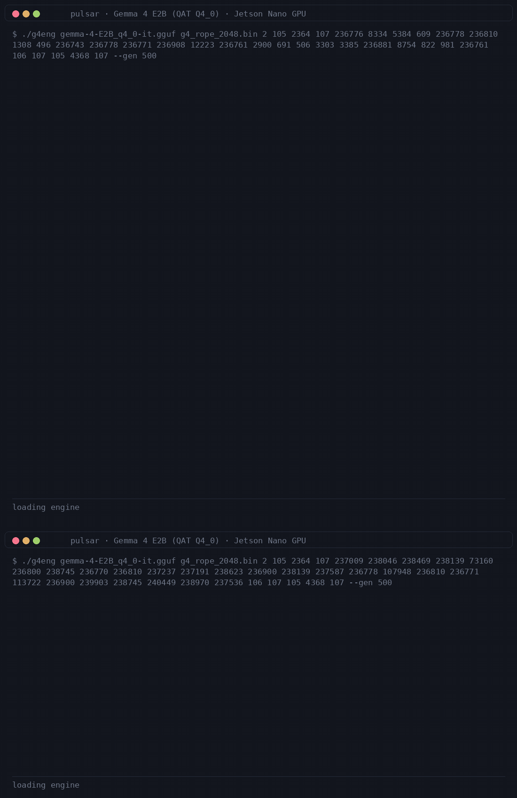

# PULSAR-ASM: Gemma 4 E2B on a Jetson Nano

Google's **Gemma 4 E2B** (text only, the QAT Q4_0 release) running at **9.5 tokens/s decode
and 15-17 tokens/s prefill on a Jetson Nano Gen1**, the 2019 4 GB board, with its 128-core
Maxwell GPU. The host side is C with the hot loops in hand-written AArch64 assembly; the
GEMVs, attention, the MLP and the per-layer-input chains run on the GPU through kernels driven
directly by the CUDA driver API. Every output bit is the same as the engine's scalar reference.

| | |
|---|---|
| Model | `google/gemma-4-E2B-it-qat-q4_0-gguf`, file `gemma-4-E2B_q4_0-it.gguf`, 3,349,516,256 bytes, sha256 `fa401b55b07ee70a54c6dae3903c783a6e65064312529ea57175cb5f8dec6634` |
| Format | Google's own: layer projections Q4_0 (quantization-aware trained), token embedding / tied head and per-layer-input table Q6_K, per-layer projection F16 |
| Engine | C + AArch64 assembly host (`pulsar_arm/gemma4nano/g4eng.c`, `g4_host.S`), GPU kernels as embedded PTX JIT-loaded by the driver (`libcuda` is opened with `dlopen`). No CUDA toolkit, cuBLAS, llama.cpp or Python at runtime; links only libc, libm, libdl, libpthread and libgomp |
| Accuracy | every kernel, CPU and GPU, bit-identical to the engine's own scalar reference (`g4ref.c`); greedy streams frozen as goldens and checked by `gates.sh` |

## Demo



Both runs are greedy and use **ceiling prompts**: the hardest of 16 probes the model answers
correctly and completely (`pulsar_arm/gemma4nano/CEILING_NANO.md`):

- **English:** "A shirt costs $25 after a 20% discount. What was the original price? Show your
  work." It answers $31.25 and checks it.
- **Traditional Chinese:** 「一列火車下午3點15分出發，車程2小時50分鐘，幾點抵達？」 It answers
  下午6點5分.

The probes also show where the model fails, and those failures are part of the record: the same
train problem asked in English gets 7:05 pm (it adds the carried hour twice), the same discount
problem asked in Chinese starts with 2500 and corrects itself only later, the haiku breaks the
5-7-5 form, and the French translation contains wrong forms.

How the clip was made: the committed engine on the Nano; both runs rerun byte-identical
(`pulsar_arm/gemma4nano/probes/*_steps.txt`); the text is the detokenized output up to the
end-of-turn token, unedited (the English answer's LaTeX is shown raw, as generated). The status
line shows the engine's own decode rate (generated steps over their wall time, median of three
runs: 9.54 and 9.55 tok/s). Reshot after the second optimization round: the faster engine
reproduces both step files byte for byte (3 runs each), only the rates changed (6.2 and
6.6 tok/s at the first shoot). Frames are rendered at a fixed cadence, not in real time.
Re-render with `python3 -I pulsar_arm/tools/make_chat_gif.py g4-nano` (Pillow and ffmpeg).

## At a glance

| | |
|---|---|
| Board | Jetson Nano Gen1: Tegra X1, 4x Cortex-A57, one Maxwell SM (sm_53), 4 GB LPDDR4 shared by CPU and GPU. L4T R32.5.1, CUDA 10.2 driver |
| Decode | **9.5 tok/s** on the English gate prompt (76 steps, 9.5-10.2); 9.5 tok/s on both demo prompts (291 and 117 steps); 9.5-9.7 tok/s over 500 steps (attention runs on the GPU, context length barely shows) |
| Prefill | **16.7 tok/s** on a 225-token prompt, 14-16.5 tok/s on short prompts: prompt tokens go through in batches of 8, each weight read once per batch |
| End to end | 225-token prompt + 128 generated tokens in 26.7 s = **13.2 tok/s** (57.1 s / 6.2 tok/s before the second optimization round) |
| Load | 3.6-3.9 s (weights repacked and uploaded) |
| Memory | 1,385-1,391 MB on the GPU (the GPU KV cache is sized to the run's positions), peak RSS 707-722 MB; the 1.93 GB per-layer-input table stays memory-mapped, one 7.4 KB row read per token |
| Context | 2048 positions; KV cache only on the 15 layers that own one (the other 20 share) |
| Clocks | not pinned (no root for `jetson_clocks`): the GPU sits at 921.6 MHz under load, the CPU governor is `schedutil`, so CPU-side timings vary by a few ms between runs |

## How it works

A token starts with its embedding row and the per-layer-input projection (F16, on the GPU),
then goes through 35 layers. Per layer, in decode:

- **GPU** (driver API: one non-blocking stream, a timing-free event polled by the host, inputs
  and outputs in mapped pinned memory, 4 synchronizations per layer):
  - the merged q+k+v GEMV;
  - **attention + o projection in one go**: scores for all 8 query heads against the single KV
    head, softmax (same double-precision `exp`, serial double sum), p·V, Q8_K, o GEMV. The
    host KV cache stays the reference; its rows are mirrored to a GPU copy as they appear;
  - the **MLP chain**: merged gate+up GEMV, GeGLU fused with Q8_K, down GEMV;
  - the **per-layer-input chain**: input-gate GEMV, GeGLU against the token's per-layer row
    fused with Q8_K, projection GEMV;
  - after the last layer, the 262,144-row Q6_K tied head.
- **CPU, AArch64 NEON assembly** (`g4_host.S`): RMS norms (the per-element `x / r` without the
  divider, see Accuracy), Q8_K of the residual stream. RoPE, the per-layer-input mixing,
  embedding rows and argmax are C.

Prefill runs the same operations per token, 8 prompt tokens at a time: the GEMVs, the head,
the F16 projection and attention are batched kernels (each weight read once for the 8 tokens),
and the per-token CPU stages of a batch run on the 4 cores. Each token still goes through
exactly the single-token arithmetic, so a prompt gives the same bits at any batch size.

The GPU kernels:

| kernel | what | speed (warm GPU) |
|---|---|---|
| `q4i_gemv5` | Q4_0 GEMV, one row per lane, weights tile-interleaved (a warp reads 512 contiguous bytes), fp16 block scales. A weight word masked with `0x000F000F` holds two nibbles, one per 16-bit half, and meets a pair of int16 activations permuted to match: one `mad.wide.s16` per half (XMAD with half selects), no per-nibble extraction. Activations staged 4,096 columns at a time | 19-22 GB/s on the large tensors, all 275 Q4_0 tensors |
| `q4i_gemv_b2` | the same for 8 prompt tokens per weight pass; token loop branch-free so the 8 integer chains interleave | 0.16-0.46 ms per token on the largest shapes |
| `q6i_gemv`, `q6i_gemv_b` | Q6_K head, one row per lane, 6-bit values paired the same way | 17.2 ms per token (20.5 GB/s); 11 ms per token in batches of 8 |
| `attn_scores`, `attn_softmax_pv` | attention for all heads, query staged transposed as float4; token dimension for prefill | ~0.3 ms per layer at 300 positions |
| `geglu_q8k2`, `q8k_dev` | GeGLU with the double-precision `exp`, fused with Q8_K | part of the chains |
| `f16_gemv_t2`, `f16_gemv_tb` | per-layer-input projection, two rows per thread from one `half2` load; batched version | 1.65 ms per token; 0.3 ms per token in batches of 8 |
| `argmax_b` | per-token argmax of the prompt batch (only index and value come back) | |

Where a decode token's ~104 ms go (CUDA-event timing on the benchmark prompt, taken one step
before the per-layer-input chain moved to the GPU): MLP chains ~53 ms and the head ~17 ms, both
near the board's DRAM bandwidth; attention + o projection ~15 ms; q+k+v and the
per-layer-input GEMVs ~13 ms (now one chain per layer); F16 projection 1.6 ms; CPU stages ~6 ms.

### Speed history, first round (English gate prompt, decode)

| step | tok/s |
|---|---|
| first light: shared forward, one synchronous copy + launch + sync per GEMV, CPU stages in C | 3.23 |
| merged q+k+v and gate+up launches | 3.49 |
| K2's driver path (stream, timing-free event, mapped pinned I/O, copy kernel) | 3.97 |
| NEON assembly: exp, GeGLU, attention scores and p·V | 4.44 |
| MLP chain on the GPU | 4.98 |
| attention for all 8 heads in one pass; NEON RMS norm and Q8_K | 5.1-5.3 |
| `q4i` row-per-lane Q4_0 kernel | 5.7-5.9 |
| `q6i` row-per-lane head (41.7 -> 18.0 ms) | 6.8-6.9 |

### Second round (benchmark: 225-token prompt + 128 generated tokens)

Each step kept only if the full gate set stayed bit-identical; median of three runs.

| step | end to end tok/s | prefill | decode |
|---|---|---|---|
| start of the round | 6.19 | 6.48 | 5.73 |
| prefill in batches of 8 (weights read once per batch) | 6.82 | 7.70 | 5.67 |
| the batch's CPU stages on 4 cores; RoPE table memory-mapped | 7.12 | 8.25 | 5.73 |
| decode attention on 4 cores | 7.28 | 8.28 | 6.03 |
| paired-nibble Q4 kernels (two nibbles per mask, XMAD half selects) | 8.25 | 9.75 | 6.51 |
| all Q4_0 tensors on the new kernel | 8.74 | 10.92 | 6.46 |
| paired 6-bit head; one batched head launch | 8.86 | 11.24 | 6.45 |
| short OpenMP spin (idle workers no longer busy-wait during GPU waits) | 9.29 | 11.70 | 6.82 |
| K/V rows prefetched during the GPU wait | 9.43 | 11.74 | 7.00 |
| decode attention + o projection on the GPU | 9.87 | 11.78 | 7.68 |
| branch-free token loops in the batched kernels | 11.24 | 15.11 | 7.74 |
| fp16 block scales (18 instead of 20 bytes per 32 weights) | 11.40 | 15.01 | 8.02 |
| F16 projection: `half2` loads, batched for the prompt | 11.51 | 15.57 | 7.95 |
| RMS-norm divides by Markstein's correction | 12.20 | 16.24 | 8.48 |
| Q4 activations staged in 4,096-column chunks (the 12,288-column down projection had 2 blocks per SM) | 12.86 | 16.00 | 9.56 |
| prefill attention on the GPU | 12.98 | 16.61 | 9.35 |
| per-layer-input chain on the GPU, GeGLU fused with Q8_K | 13.21 | 16.74 | 9.62 |

Tried and dropped (both rounds in `pulsar_arm/gemma4nano/PORT_PLAN.md`): a head kernel built on 16-bit multiplies in plain C (slower: the compiler
kept the byte extracts; inline PTX on register halves was what worked), deeper load rings and
register caps for the Q4 and head kernels (spills and lost overlap cost more than the
occupancy gained), prompt batches of 16 (the batched kernels are bound by per-token integer
work, not by weight reads), parallel RMS norms (waking OpenMP workers after each GPU wait costs
more than the divides), fewer kernel launches by fusing tiny kernels (a launch costs ~50 µs of
CPU, but it is hidden behind GPU work), GPU argmax for greedy decode and Markstein softmax
divides on the GPU (real but under 1%).

## Accuracy

`g4ref.c` is the scalar reference that **defines** the engine's arithmetic: activations
quantized to Q8_K, exact integer dots with fixed-order float accumulation, float64 norms,
softmax and GeGLU through its own `exp` (only IEEE `+ - * /` and exponent assembly, within 1
ulp of libm), baked rope tables, greedy argmax on the raw logits. The engine runs that same
forward pass (shared code) with its GEMVs and hot loops swapped for GPU kernels and assembly,
each proved bit-identical:

- `g4host_test`: 16.8 M `exp` values, 4.2 M GeGLU values, attention at 12 window
  configurations and both head sizes, 3.07 M RMS-norm outputs, 51,500 Q8_K blocks, all identical.
- `g4gemv_test`: all 275 Q4_0 tensors, the full 262,144-row head and the F16 projection on three
  activation vectors each; the batched kernels (10 Q4_0 shapes x 8 tokens, the head and argmax
  x 8 tokens, the F16 projection at 8 and 5 tokens); GPU attention at 42 configurations
  (single tokens, prompt batches, a batch crossing the 512-position window edge); GeGLU, Q8_K
  and the fused GeGLU + Q8_K; all identical.
- The RMS norms compute `x / r` as `q0 = x·y; q = fma(fma(-q0, r, x), y, q0)` with `y = 1/r`
  rounded once (Markstein's correction), which is the correctly rounded quotient; besides the
  theorem, `markstein_check.c` compared it with the IEEE division on 2.5·10^11 (float, double)
  pairs, every float significand included: no difference. `g4host_test` keeps comparing the
  assembly against the C reference, which still divides.
- `gates.sh` runs both tests and checks the engine's English (97 steps) and Traditional Chinese
  (222 steps) greedy streams against `golden_en.txt` / `golden_zh.txt` (English also with
  `--batch 1`, the token-by-token prefill), and a sampled English
  stream (temperature 1.0, top-k 64, top-p 0.95, seed 7; 135 steps) against `golden_en_s7.txt`:
  the reference on x86 and the engine on the Nano draw the same tokens.

**What "bit-exact" does not cover.** It is exact against `g4ref.c`, not against Hugging Face or
llama.cpp. Quantizing activations to Q8_K changes the logits slightly: against a float reference
on the same dequantized weights (`g4_np.py`, which mirrors the x86 port's HF-checked reference),
the English answer is token-for-token identical, while the Chinese one is identical up to
generated token 32, then takes a different but equally correct path. The contract also excludes
non-finite inputs (NaN payloads differ between ARM and the GPU); GEMV outputs are always finite.

Before anything was built, `g4_q4check.py` checked the source: all 275 Q4_0 tensors in Google's
GGUF are byte-identical to ggml's Q4_0 quantization of the QAT bf16 checkpoint, so the GGUF is
exactly "the QAT weights in Q4_0".

## Limits

- The demos are greedy. Sampling exists (`--sample temp topk topp seed`, Hugging Face's order:
  cap, temperature, top-k, top-p, one xorshift64* draw) and is deterministic per seed, but it
  has not been evaluated for quality here; the model card recommends 1.0 / 64 / 0.95.
- One sequence; 2048-position context; prefill in batches of 8 tokens.
- Measured on an unpinned board: absolute numbers move a few percent between runs.
- The model's own ceiling: multi-step arithmetic is unreliable (see the probes), long answers
  and code often exceed 500 tokens.

## Build and run

On the Nano (gcc 7.5 and the L4T driver; no toolkit needed):

```sh
cd pulsar_arm/gemma4nano
sh build.sh                                              # g4eng, g4gemv_test, g4host_test
python3 -I g4_rope.py g4_rope_2048.bin 2048              # rope tables (any machine with numpy)
sh gates.sh gemma-4-E2B_q4_0-it.gguf g4_rope_2048.bin    # all accuracy gates
./g4eng gemma-4-E2B_q4_0-it.gguf g4_rope_2048.bin <prompt ids...> --gen N [--sample 1.0 64 0.95 <seed>]
# prints: step <n> id_in=<id> top=<id> logit=<x.xxxx> [pick=<id>]   (logit after the 30*tanh(x/30) cap)
```

Prompt ids come from the model's `tokenizer.json` with the chat template
`<bos><|turn>user\n{prompt}<turn|>\n<|turn>model\n` (`pulsar_arm/gemma4nano/prompts.json` has two
examples). `--batch B` sets the prompt batch (1 to 8, default 8). Switches for A/B:
`G4FAST=0` (plain synchronous copies), `G4Q4I=0` (K2 kernel only), `G4GPUMLP=0` (MLP stages on
the CPU), `G4GPUATTN=0` (attention on the CPU), `G4GPUPLE=0` (per-layer input with a CPU
GeGLU), `G4PAR=0` (no CPU threads), `G4HEAD1=1` (prompt head one token per launch), `G4ASM=0`
(C host loops), `G4PROF=1` (per-hook timing). The engine sets `GOMP_SPINCOUNT=10000` for
itself (OpenMP workers must not busy-wait while the GPU runs) unless that or
`OMP_WAIT_POLICY` is already set.
`g4_kernels.ptx` is regenerated from `g4_kernels.cu` with
`nvcc -arch=compute_53 -ptx -fmad=false -O3` and embedded by `g4_embed_ptx.py`.

## Layout

```
pulsar_arm/gemma4nano/g4ref.c         the reference: GGUF loader, arithmetic contract, forward pass, hooks
pulsar_arm/gemma4nano/g4eng.c         the engine: GPU upload and kernels behind the hooks, driver path
pulsar_arm/gemma4nano/g4_host.S       AArch64 NEON host kernels; g4_hostglue.h is their C side
pulsar_arm/gemma4nano/g4_kernels.cu   GPU kernels (q4i, q6i, attention, GeGLU, Q8_K, F16); g4_ptx_q4.h is K2's kernel
pulsar_arm/gemma4nano/g4*_test.c      bit-exactness tests; gates.sh, build.sh
pulsar_arm/gemma4nano/markstein_check.c   the division check behind the RMS-norm divides
pulsar_arm/gemma4nano/*.py            GGUF reader, Q4_0 cross-check, dequantizer, float reference, rope tables
pulsar_arm/gemma4nano/PORT_PLAN.md    the port's log: milestones, measurements, what was dropped and why
doc/K2_HORIZON_JETSON_NANO.md         the K2-Horizon-0.9B Nano engine this port builds on
doc/OTHER_ENGINES.md                  the earlier engines (Pi 4 Gemma-3, Bonsai, phone)
```
