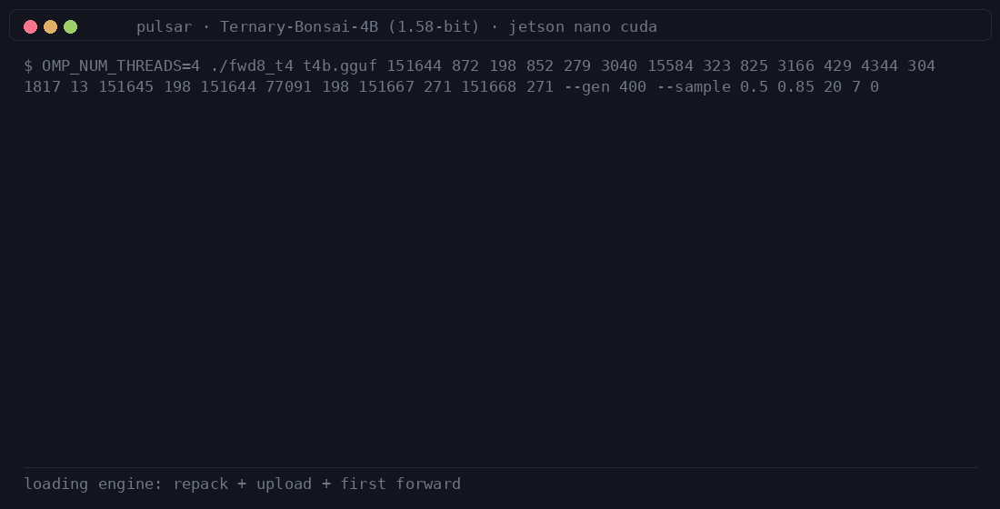
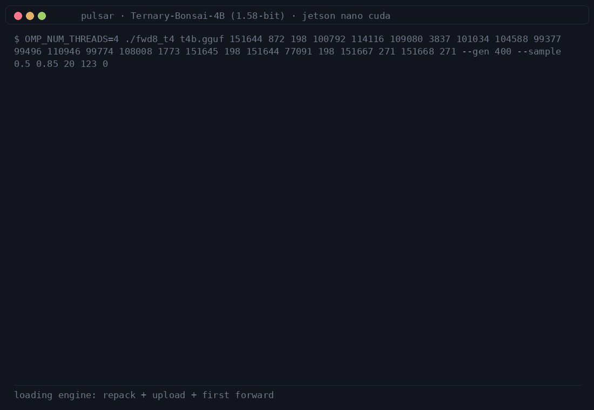

# PULSAR-ASM: Bonsai-8B 1-bit on a Jetson Nano

An 8-billion-parameter language model running at **16.5 tokens/s on a
Jetson Nano Gen1**, the 2019 4 GB board, using its 128-core Maxwell GPU.
The model is PrismML's **Bonsai-8B** (Qwen3-8B architecture) in the
`Q1_0` format: true 1-bit weights, one sign bit per weight plus one f16
scale per 128-weight block.

| | |
|---|---|
| File | `Bonsai-8B-Q1_0.gguf`, 1,158,654,496 bytes, sha256 `284a335aa3fb2ced3b1b01fcb40b08aa783e3b70832767f0dd2e3fdfa134bd54` |
| Streamed per token | ~1.06 GB of weights |
| Engine | C + CUDA (sm_53), written for this board. No llama.cpp, no cuBLAS, no Python at runtime; the binary links only `libcudart`, `libgomp`, libc/libm/libpthread and libstdc++ |
| Accuracy | every GEMV kernel bit-exact against a host reference of the PrismML llama.cpp fork's Q1_0 arithmetic; greedy streams frozen as goldens and enforced by a gate on every change |

## Demo

Both clips play in real time: each token appears at the moment the engine
produced it, using the per-step times from the run's own log. Loading
(weight repack + upload) and prompt processing are shown at their measured
durations too.

**English** (seed 7, 106 tokens, decode 15.8 tok/s)


**Traditional Chinese** (seed 123, 251 tokens, decode 15.3 tok/s)


How the clips were made:

- Engine code is the committed `bonsai-jetson-nano` HEAD (bfabc8a),
  built with `.auto/build_q1.sh`, on a Nano with `jetson_clocks`
  (GPU 921.6 MHz, CPU 1.479 GHz), L4T R32.5.1, CUDA 10.2.
- The prompts are "List the four seasons and one thing that changes in
  each." and "請列出四季，以及每一季會改變的一件事。", wrapped in the
  model's chat template with an empty think block. Prompt ids came from
  `llama-tokenize` against the same GGUF.
- Sampling uses the GGUF's own recommended settings: temperature 0.5,
  top-p 0.85, top-k 20.
- Both runs stopped on their own at end-of-sequence.
- The commands, as shown in the clips:

  ```sh
  OMP_NUM_THREADS=4 ./fwd8_q1 b8q1.gguf 151644 872 198 852 279 3040 15584 323 825 3166 429 4344 304 1817 13 151645 198 151644 77091 198 151667 271 151668 271 --gen 400 --sample 0.5 0.85 20 7
  OMP_NUM_THREADS=4 ./fwd8_q1 b8q1.gguf 151644 872 198 100792 114116 109080 3837 101034 104588 99377 99496 110946 99774 108008 1773 151645 198 151644 77091 198 151667 271 151668 271 --gen 400 --sample 0.5 0.85 20 123
  ```

- The text is the model's output, detokenized and not edited. The
  Chinese answer has 1-bit-model slips, kept as generated: "溫度
  gradually 上升", "蜂群越winter", and winter given "長日" (long days).
- 15.8 and 15.3 tok/s are lower than the 16.51 headline below because
  these runs go deeper into the context (up to position 275, against 44 in
  the harness; attention grows with it, steps go from ~61 to ~76 ms),
  sample on the host from the full logits (0.4 ms/token), and ran in a
  different hour on the same board, which drifts 2–6 %. The headline is
  the greedy harness number.
- The transcripts and per-token times are literals in
  `pulsar_arm/tools/make_chat_gif.py`, so re-rendering can only reproduce
  these frames: `python3 pulsar_arm/tools/make_chat_gif.py
  bonsai8b-q1-nano-en bonsai8b-q1-nano-zh-tw` (needs Pillow ≥ 8.2 and
  ffmpeg).

### Ternary-Bonsai-4B

The same two prompts, seeds and sampling on the 4B ternary checkpoint
(1.58-bit weights, `-DPQ1_TERN -DBONSAI_4B` build), with the engine's
default TurboQuant 4-bit KV cache.

**English** (seed 7, 92 tokens, decode 14.6 tok/s)



**Traditional Chinese** (seed 123, 386 tokens, decode 14.2 tok/s)



How the clips were made:

- Engine code is the committed `bonsai-jetson-nano` HEAD (8fd086d),
  built with `.auto/build_t4.sh`, same board and clocks as above
  (`jetson_clocks`, GPU 921.6 MHz, CPU 1.479 GHz).
- The commands, as shown in the clips (the trailing `0` is min-p):

  ```sh
  OMP_NUM_THREADS=4 ./fwd8_t4 t4b.gguf 151644 872 198 852 279 3040 15584 323 825 3166 429 4344 304 1817 13 151645 198 151644 77091 198 151667 271 151668 271 --gen 400 --sample 0.5 0.85 20 7 0
  OMP_NUM_THREADS=4 ./fwd8_t4 t4b.gguf 151644 872 198 100792 114116 109080 3837 101034 104588 99377 99496 110946 99774 108008 1773 151645 198 151644 77091 198 151667 271 151668 271 --gen 400 --sample 0.5 0.85 20 123 0
  ```

- Token ids were decoded with the 4B GGUF's own vocabulary. The text
  is not edited.
- Loading takes 9.5 s, against 2.4 s for the 8B, because the ternary
  weights are repacked on the CPU before upload. The clips show the
  measured time.
- Decode steps run 68–70 ms in the English run. In the Chinese run they
  grow to 74 ms by position 410, as attention grows with the context,
  plus one 108 ms step. Prompt processing runs at 14.3 tok/s.
- Both runs ended on a sampled end-of-sequence. The Chinese one ends
  partway through the autumn list, on an empty `-` bullet, and never
  reaches winter. That is the model's own stop and is kept as is.
- The Chinese answer has other slips, kept as generated:
  - Japanese 気 instead of 氣, twice, and the simplified 树.
  - "花朵開開".
  - For summer, "影子最長" (shadows longest) and "水資源干涸".
- The TurboQuant cache is lossy. With the exact f16 cache
  (`PQ1_KVTQ=0`), seed 123 samples a different token at step 5 and
  writes a different answer. The f16 path is the one gated bit-exact
  against the fork.
- Re-render with `python3 pulsar_arm/tools/make_chat_gif.py
  bonsai4b-ternary-nano-en bonsai4b-ternary-nano-zh-tw`.

## At a glance

| | |
|---|---|
| Board | Jetson Nano Gen1: Tegra X1, 4× Cortex-A57, one Maxwell SM (sm_53, 128 cores), 4 GB LPDDR4 shared by CPU and GPU; measured streaming ceiling 21.9 GB/s |
| Decode | **16.51 tok/s** (60.6 ms/token), up from 2.13 at the first working build |
| Prefill | 16.19 tok/s (token by token through the decode path) |
| Startup | ~2.4–2.5 s (repack + upload + first forward) |
| Peak RSS | 325–773 MB, set by the board's page-cache state rather than the code: unchanged binaries read 596, 680, 730 and 770 MB over one session, and in the A/B for 11806d3 both arms read ~770 MB. GGUF pages are dropped once each tensor is on the GPU |
| GPU memory | 1280 MB arena, 1025.1 MB used (weights, K/V cache, staging) |
| Bandwidth | ~17.1 GB/s of 21.9 (78 %); the GEMV kernels alone run at 16.5–20.6 GB/s, up to 94 % of the ceiling |
| Conditions | cold harness run, prompt A (20 prompt ids + 24 greedy tokens), `jetson_clocks`, cpuidle c7 off |

## How it works

At load, the 1-bit weights are repacked into a 1280 MB GPU arena. After
the first token, a whole decode step is **one CUDA graph**: per layer,
residual add + RMS norm + Q8_K activation quantization, the merged q+k+v
GEMV, attention, the o projection, the FFN, and finally the 151,669-row
output head and, for greedy decoding, the argmax over its logits, with
the hidden state kept on the GPU throughout. The CPU copies in the
embedding row and the rope table; greedy decoding copies out only the
winning token id and logit, sampling copies out the full logits and draws
on the host.

- **GEMV kernel** (`pq1_gemv_hs` in `pq1_swar_sm53.cu`) multiplies 1-bit
  weights by int8 activations. It is **group-stationary**: each lane keeps
  one 128-wide K group's activation bit planes in registers (sign plus 7
  magnitude planes) and streams weight rows past them. It reduces each
  row-group product with a Harley-Seal carry-save tree of LOP3 full adders
  and POPC, tuned to sm_53's quarter-rate POPC pipe. The integer sums are
  exact, and the fp epilogue adds the per-group products in the host
  reference's order; the K=4096 shapes defer
  the row sums over three batches so 18 lanes reduce at once instead of 6.
  The earlier bit-serial T-MAC kernel and three SWAR
  kernels are kept as fallbacks and parity references.
- **Merged tensors.** q, k and v are one 6144-row tensor; gate and up are
  one 24576-row tensor. Fewer launches, fuller waves on the one SM.
- **Fused activation prep.** The RMS-norm and silu kernels quantize to
  Q8_K and build the GEMV's bit planes in the same launch. The RMS sum is
  computed as a parallel double tree, and it is used only when it rounds
  to the same float as fwd8's serial chain; otherwise the kernel runs the
  serial chain.
- **Attention on the GPU:** per-head RMS norm, YaRN rope, K/V cache store,
  q·k, an online softmax (prefix maxima by warp shuffle scan) and p·v. The
  K/V cache lives in the arena. The per-head norm and rope run one head
  per warp over five blocks (10 µs per layer).
- **FFN on the GPU:** gate+up, silu(g)·u with an `expf` that reproduces
  glibc's bit for bit, activation quantization and the down projection.

GEMV time per token (nvprof, prompt A): q+k+v 190 µs, o 138 µs, gate+up
681 µs, down 406 µs, each × 36 layers, plus the head at 4.2 ms (bfabc8a).
That is ~55 ms of the ~61 ms step (~91 %), at 16.5–20.6 GB/s per kernel
against the 21.9 GB/s streaming ceiling; the big shapes keep their whole
row batch's loads in flight at 24 resident warps. The rest is attention, norms and the silu `expf`.

Every step above was kept only after an order-balanced A/B on the same
board in the same hour, with all three accuracy gates green on a fresh
build. Each has a switch to turn it off (`PQ1_FFN=0`, `PQ1_ATT=0`,
`PQ1_TM=0`, `PQ1_HS=0`, `PQ1_TOK=0`,
`PQ1_GRAPH=0`, ...). The full record, including every idea
that was measured and rejected, is `.auto/HANDOFF_NANO_Q1_0.md`.

## Accuracy

`.auto/checks.sh` rebuilds from the working tree and runs three gates.
They are never overridden:

1. `pq1_parity`: all four GEMV kernels bit-exact against the host
   reference (`pq1_host.c`) at K = 4096 (256/256 rows) and K = 12288
   (512/512 rows).
2. The 44-token greedy stream on prompt A equals `.auto/golden_q1_A.txt`.
3. The 26-token greedy stream on held-out prompt B equals
   `.auto/golden_q1_B.txt`.

`PQ1_ATT_CHECK=1` and `PQ1_FFN_CHECK=1` rerun the host attention or FFN
after every GPU layer and compare bitwise (0 mismatches over 1548
layer-steps).

**Divergence from the fork, disclosed.** The engine quantizes activations
to **Q8_K** (256-wide blocks, fp32 scale), a choice inherited from the
earlier 2-bit path. The fork's Q1_0 dot product uses **Q8_0** (32-wide
blocks, f16 scale). The engine is therefore not logit-identical to the
fork. On prompt A it produces the same greedy stream as the fork for all
25 generated tokens, but the logits differ slightly: at step 19 the top
logit is 19.8211 here and 19.8919 in the fork. The goldens freeze the
engine's own exact path. Note that the fork's own greedy stream is not
unique either: on a long Traditional Chinese prompt, flash attention on vs
off first differs at token 36, and 20 threads vs 1 thread at token 32.

## Build and run

Everything builds on the Nano (CUDA 10.2, gcc 7.5). The exact recipe is
`.auto/build_q1.sh`; in short:

```sh
cd pulsar_arm/bonsai2
nvcc -gencode arch=compute_53,code=sm_53 -O3 -maxrregcount=48 --use_fast_math \
     -Xptxas -O3,-dlcm=ca -std=c++11 -c pq1_swar_sm53.cu -o pq1_swar_sm53.o
CF="-O2 -fopenmp -mcpu=cortex-a57 -DSTANDALONE"
INC=-I/usr/local/cuda-10.2/targets/aarch64-linux/include
gcc $CF -ffp-contract=off -DPQ1_REAL_CUDA -c pq1_host.c -o pq1_host.o
gcc $CF -DPQ1_USE_CUDA -DBQ1_TIME -include pq1_fwd8_shim.h -c fwd8.c -o fwd8_q1.o
gcc $CF -DPQ1_USE_CUDA $INC -c pq1_fwd8_glue.c -o pq1_glue.o
g++ fwd8_q1.o pq1_host.o pq1_glue.o pq1_swar_sm53.o -o fwd8_q1 \
    -L/usr/local/cuda-10.2/targets/aarch64-linux/lib -lcudart -lm -lpthread -fopenmp
```

Run:

```sh
sudo jetson_clocks                     # fixed clocks; numbers above assume this
OMP_NUM_THREADS=4 ./fwd8_q1 Bonsai-8B-Q1_0.gguf <prompt ids...> --gen N [--sample temp top_p top_k seed [min_p]]
```

Without `--sample` the engine decodes greedily. The engine takes and
prints token ids; there is no tokenizer on the board. Tokenize the chat
template on another machine with `llama-tokenize` from a llama.cpp build
that knows Q1_0 (the PrismML fork), or with
`pulsar_arm/bonsai2/tokdetok.cpp` built against it, which also turns the
printed ids back into text.

## Measurement harness

Run from a host with ssh access to the board (the scripts default to
`pesi@100.70.245.36`; set `NANO=` to change it). They copy the sources,
build on the board and run there.

```sh
bash .auto/measure.sh                 # build -> prompt A -> METRIC decode_tps / prefill_tps / peak_rss_mb lines
bash .auto/checks.sh                  # the three accuracy gates (needs a prior measure.sh)
bash .auto/ab_pair.sh "PQ1_TM=0" 2    # order-balanced A/B of an engine switch, 2 pairs
PQ1_EXTRA="PQ1_KTIME=1" bash .auto/measure.sh   # engine env vars reach the board only through PQ1_EXTRA
```

Useful engine switches: `PQ1_KTIME=1|2|3` (per-shape / per-phase / API
timing), `PQ1_CPUTIME=1` (per-pass CPU budget), `PQ1_STATS=1` (GPU memory
and graph counters at exit, the proof that a code path actually ran),
`PQ1_TRACE=1`.

The board drifts 2–6 % from hour to hour, so a number is only compared
with another from the same A/B job, never with one from another run.

## Limitations and work in progress

- Context is capped at 512 tokens, and the prompt is processed one token
  at a time through the decode path (no batched prefill).
- One sequence at a time.
- **In progress:** a 4096-token context with an f16 K/V cache whose
  attention arithmetic follows the fork's flash-attention decode path
  (`.auto/FORK_F16_FA_SPEC.md`). Decode speed will then also be reported
  at depth, on a 3197-token Traditional Chinese prompt
  (`.auto/prompt_zh_tw.txt`).

## Layout

```
pulsar_arm/bonsai2/pq1_swar_sm53.cu   GPU kernels: hs, T-MAC + SWAR GEMVs, attention, FFN, rms/quant
pulsar_arm/bonsai2/pq1_fwd8_glue.c    repack, GPU arena, merged tensors, CUDA graphs, dispatch, timers
pulsar_arm/bonsai2/fwd8.c             engine: layer loop, CPU passes, sampler (compiled with pq1_fwd8_shim.h)
pulsar_arm/bonsai2/pq1_host.c         host reference the kernels must match bit for bit; OpenMP repack
pulsar_arm/bonsai2/pq1_parity.c       parity gate: ./pq1_parity <rows> <K> all
pulsar_arm/bonsai2/bq1_*, pq2_*       earlier Nano paths (sign-projected, 2-bit), kept for reference
pulsar_arm/tools/make_chat_gif.py     demo renderer; transcripts and timings are literals
.auto/                                harness scripts, goldens, HANDOFF_NANO_Q1_0.md, ideas.md (history)
autoresearch/                         per-loop results tables and discarded patches
doc/                                  demo GIFs; OTHER_ENGINES.md
```

## Other engines in this repository

This repository started as pure-assembly inference engines. They are
still here and still work: a single static AArch64 binary that runs
Gemma-3 on a Raspberry Pi 4 with no libc, the C + NEON Bonsai port that
runs Ternary-Bonsai 8B and 27B on a DGX Spark CPU, and the original x86-64
Gemma engines. See [doc/OTHER_ENGINES.md](doc/OTHER_ENGINES.md) and
[pulsar_arm/bonsai2/README.md](pulsar_arm/bonsai2/README.md).
